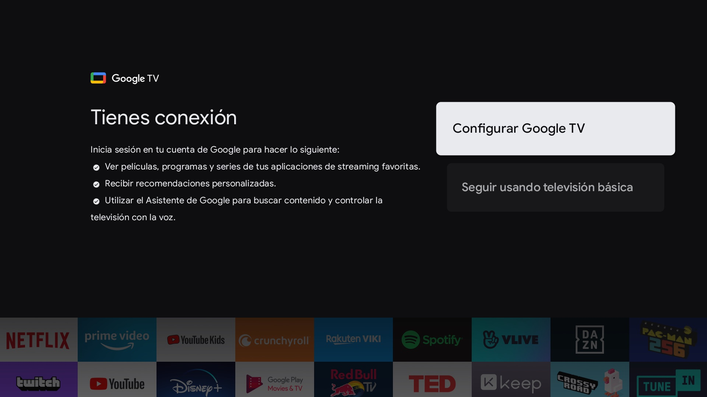
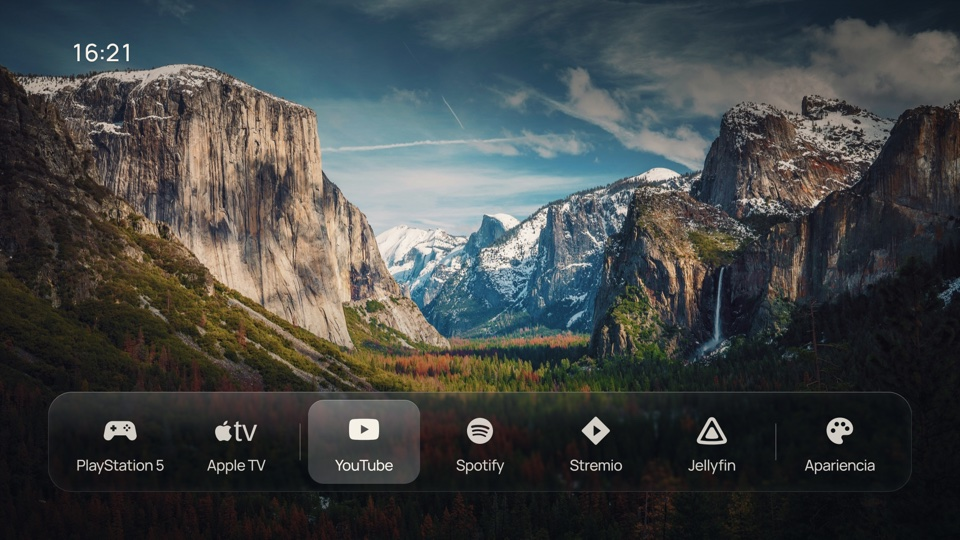
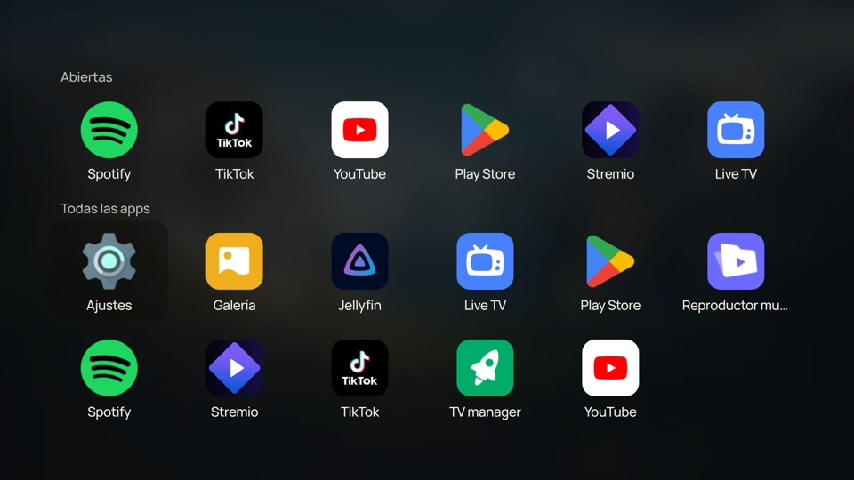
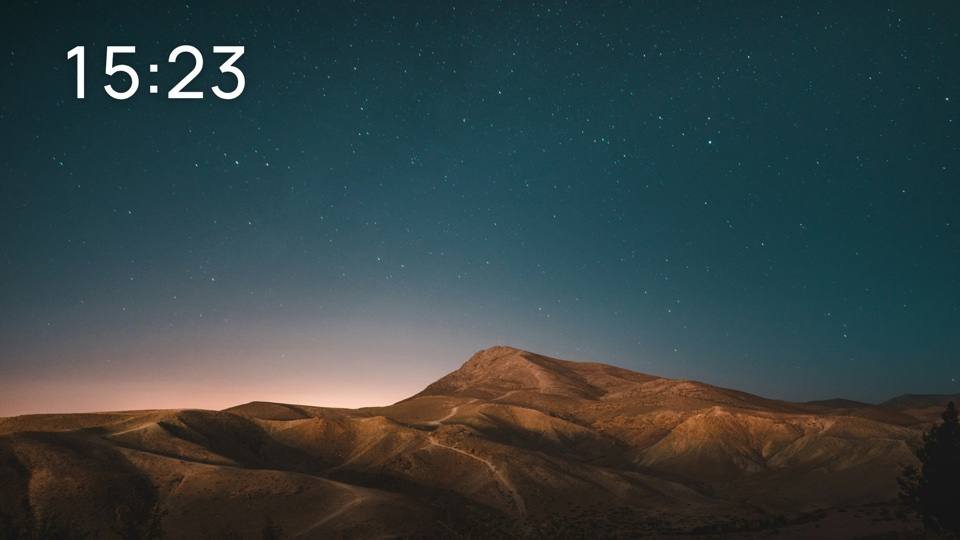

# CleanXiaomiFrame

A quiet home screen for a Xiaomi Google TV: a photograph, the time, your HDMI devices and a few apps, with nothing else in the way.

CleanXiaomiFrame takes [CleanFrame](https://github.com/nthnclrk/CleanFrame), a Samsung The Frame launcher, and runs it on Android TV, using what [CleanXiaomiTV](https://github.com/majnioui/CleanXiaomiTV) learned about taming a Xiaomi TV: the debloat list, the remote's buttons, and how to take Home away from Google TV.

| Before: stock Google TV | After: CleanXiaomiFrame |
| --- | --- |
|  |  |

| All apps (remote's Apps button) | Screensaver |
| --- | --- |
|  |  |

**Built and tested on** a Xiaomi MiTV-MOOR4 (venom), Google TV / Android 11, MediaTek, 4K panel with a 1080p interface. The interface text is in Spanish.

## What it does

- **Home**: one photograph from a set of fifteen, a 24-hour clock and a glass dock. Optional wallpaper rotation, list or dock layout, fonts and focus styles from the **Apariencia** tile.
- **HDMI devices in the dock**: the TV's HDMI-CEC devices (PlayStation 5, Apple TV…) appear on their own at the start of the dock, named as they announce themselves, and switch the TV to their input. They follow a device to another port, and stay while it is off.
- **Your apps**: add, remove and reorder them under Apariencia → Apps. Apps you uninstall leave the dock by themselves.
- **All apps**: the remote's Apps button opens a Launchpad-style grid of every installed app, with an **Abiertas** row of recently used apps on top. Hold OK on an app to close it or open its page in TV settings (Force stop, Clear data).
- **Screensaver**: the same photographs, one a minute with a crossfade, and the clock.
- **Remote buttons**: Settings opens the TV settings, YouTube opens YouTube, Apps opens All apps; the Xiaomi TV+, Netflix and Prime Video buttons do nothing. Volume and Input are untouched.
- **Navigation sounds**: the TV's own system sounds when focus moves.

## Install it on your TV

The [Xiaomi TV setup guide](docs/android-xiaomi.md) covers building the APK, installing it over ADB, the permissions it needs, making it the Home screen and the screensaver, the optional [debloat list](android/debloat-xiaomi.txt), and how to undo every step.

You need a computer on the same network with ADB, a JDK and the Android SDK (platform 36). Everything is done over ADB from that computer; nothing is downloaded on the TV except from Play Store.

## Try the interface in a browser

The launcher is a web app (`app/`), so you can preview and change it on a computer first. You need Node.js 22+ and Python 3.10+.

```sh
npm ci
npm run dev:public
```

Open [localhost:4795/home/](http://localhost:4795/home/) and use the arrow keys, Enter and Escape. Opening apps and switching inputs only works on the TV; the preview shows two sample HDMI devices.

## How it is built

| Location | What it is |
| --- | --- |
| `app/` | The launcher itself: HTML, CSS and ES5 JavaScript, shared with the original Samsung build |
| `app/device.js` | The TV bridge: Android (`window.CleanFrameHost`) or Samsung Tizen |
| `android/` | The Android app: a WebView Home activity, the screensaver, and the remote-button accessibility service |
| `android/debloat-xiaomi.txt` | Packages disabled on the reference TV |
| `docs/android-xiaomi.md` | Setup, permissions and recovery on a Xiaomi Google TV |
| `docs/`, `scripts/` | CleanFrame's original Samsung The Frame documentation and tools |

The Samsung files are kept from CleanFrame, but the interface changes made here (no on-screen Art Mode or Samsung controls, Spanish text) have only been tested on Android.

## Credits

- **[CleanFrame](https://github.com/nthnclrk/CleanFrame)** by [Nathan Clark](https://github.com/nthnclrk): the launcher design, interface, wallpapers, materials and their asset records. MIT.
- **[CleanXiaomiTV](https://github.com/majnioui/CleanXiaomiTV)** by [majnioui](https://github.com/majnioui), itself built on [CleanYourTV](https://github.com/Gathin23/cleanyourtv) by [Gathin](https://github.com/Gathin23): the Xiaomi debloat list, the remote-key accessibility approach and the notes on replacing the Google TV launcher. MIT.

Fonts, photographs and brand marks keep their own terms: see [THIRD_PARTY_NOTICES.md](THIRD_PARTY_NOTICES.md). This project has no affiliation with Xiaomi, Google, Samsung or any streaming service.

## Licence

MIT, see [LICENSE](LICENSE).
